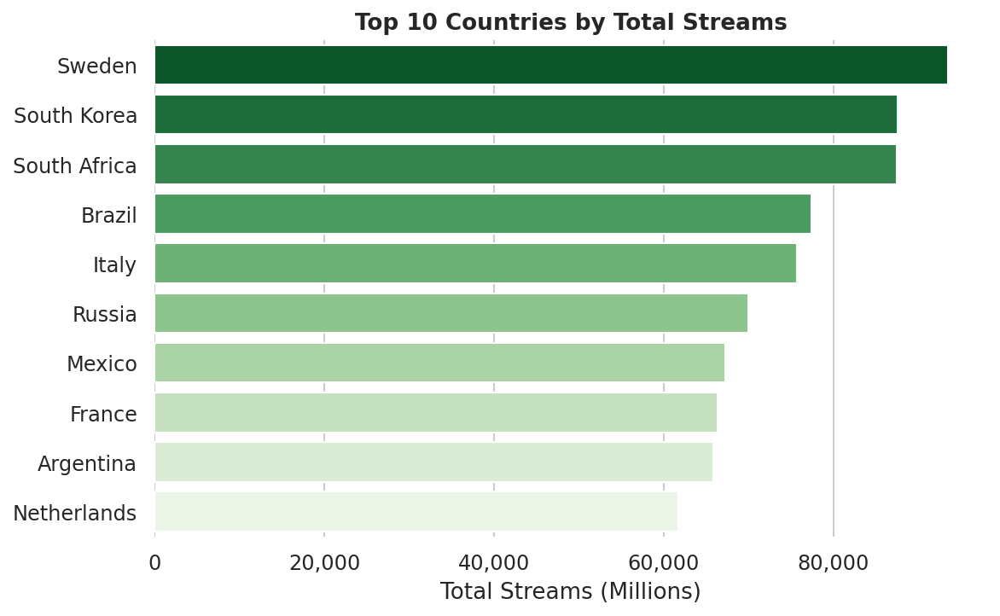
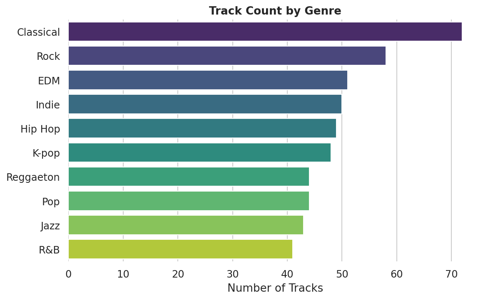
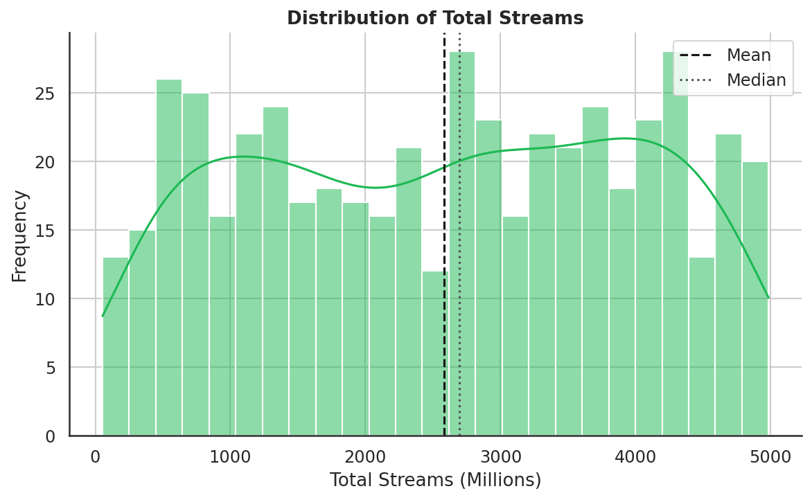
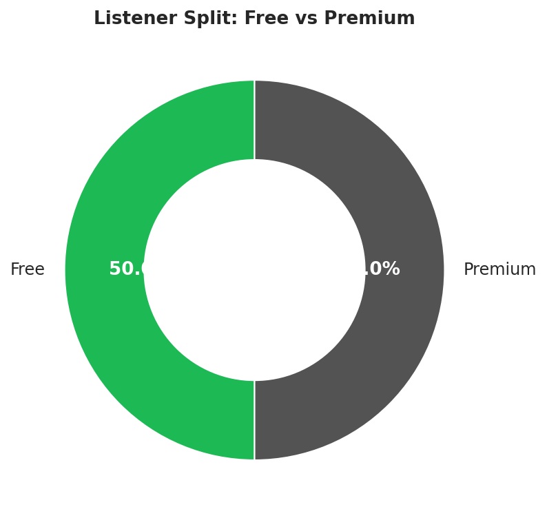
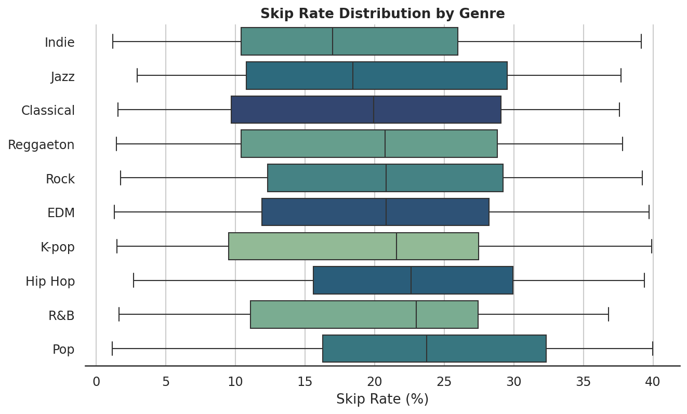
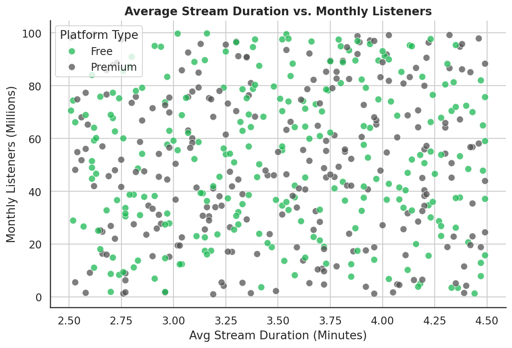
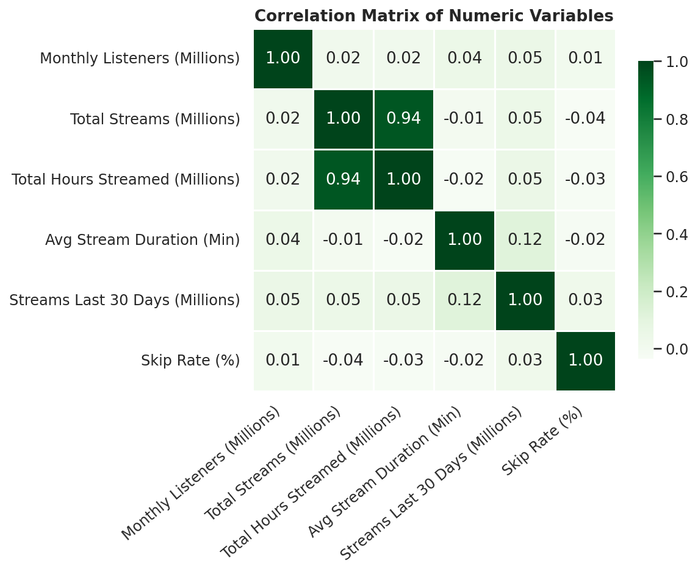

# Spotify 2024 Global Streaming Data Analysis

Statistical analysis and visualization of Spotify's 2024 global streaming dataset — 500 tracks spanning 10 genres and dozens of countries, examined for listening patterns, genre popularity, and platform behavior.

**Author:** Joseph Kayijuka

---

## Project Overview

This project explores what drives streaming volume and listener engagement across Spotify's global catalog in 2024. It covers:

- Data cleaning and quality checks
- Descriptive statistics (central tendency, dispersion, skewness, kurtosis)
- Visual analysis across country, genre, platform type, and engagement metrics
- A correlation analysis of the dataset's numeric variables

## Repository Structure

```
spotify-2024-analysis/
│
├── data/
│   └── spotify_2024_global_streaming_data.csv
│
├── notebooks/
│   └── spotify_2024_streaming_analysis.ipynb
│
├── images/
│   ├── top_countries_by_streams.png
│   ├── genre_distribution.png
│   ├── streams_distribution.png
│   ├── platform_split.png
│   ├── skip_rate_by_genre.png
│   ├── duration_vs_listeners.png
│   └── correlation_heatmap.png
│
├── reports/
│   └── spotify_2024_streaming_analysis.pdf
│
├── README.md
└── requirements.txt
```

## Key Insights

- **Top country by total streams:** Sweden (93,449.76M streams), ahead of South Korea and South Africa
- **Top country by monthly listeners:** Russia (1,603.45M listeners)
- **Most represented genre by track count:** Classical, ahead of Rock and EDM
- **Skewness of Total Streams:** ≈ -0.05 — a near-symmetric distribution, not dominated by a handful of viral outliers
- **Kurtosis of Total Streams:** ≈ -1.24 — flatter than a normal distribution, meaning streams are spread fairly evenly across tracks
- **Total Streams vs. Total Hours Streamed:** strongly correlated (r ≈ 0.94), as expected
- **Skip Rate** shows little to no correlation with any other numeric variable in the dataset

## Visualizations

| | |
|---|---|
|  |  |
|  |  |
|  |  |

**Correlation matrix of numeric variables:**



## How to Run

```bash
git clone https://github.com/josekay123/spotify-2024-analysis.git
cd spotify-2024-analysis
pip install -r requirements.txt
jupyter notebook notebooks/spotify_2024_streaming_analysis.ipynb
```

## Technologies

- Python
- pandas, numpy
- matplotlib, seaborn
- scipy

## Sources

- Spotify. (2024). *Streaming Data API Documentation.* https://developer.spotify.com/documentation/web-api
- Kaggle. (2024). *Spotify 2024 Global Streaming Dataset.*
